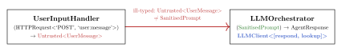
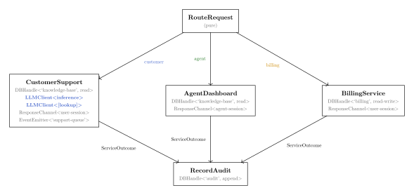
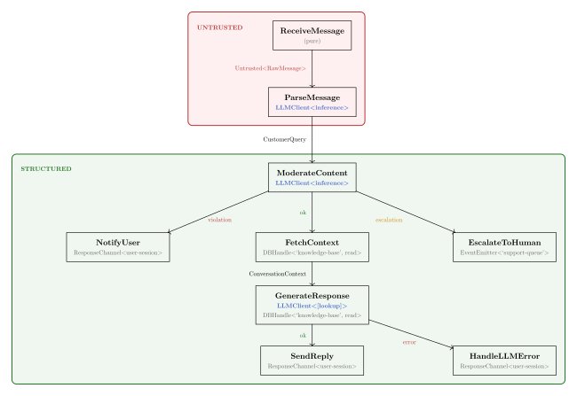

# Architecture as Program: Capability-Injected, Model-Driven Software Development in the Age of AI Agents 

**Yoni Lavi\
Codeliance**

**June 2026**

**Preprint · [doi:10.5281/zenodo.21473361](https://doi.org/10.5281/zenodo.21473361) · CC BY 4.0**

**Note on process.** This proposal was developed collaboratively with Claude (Anthropic), which served as primary drafter under the author's direction. The architectural vision and synthesis are the author's; the literature survey, formal framing, and prose were produced by the AI and verified against primary sources. This transparent accounting reflects the proposal's own thesis: that the interesting artifact is the *intent*, not the implementation, and that honest attribution of AI contribution is preferable to ambiguity.

**Abstract.** AI coding agents have removed the thirty-year obstacle to graph-based code representations: the human preference for text. This proposal describes a development model in which the primary artifact is a *signal graph* (a functional reactive program with explicitly typed capability boundaries) that serves simultaneously as architecture model, security policy, and source of truth. Implementation code is typically a compiled artifact generated by AI agents within capability-restricted sandboxes; existing code can be incorporated as opaque nodes with explicit capability signatures, giving a migration path that does not demand rewriting up front. We synthesise functional reactive programming, object-capability security, and trust-annotated information flow into a single architectural substrate, and argue that this synthesis is newly practical due to the convergence of agent-authored code, lightweight sandboxing (WASM/WASI, BEAM), and capability hardware (CHERI). The proposal presents a three-phase research agenda, from core demonstrator through formal verification, and identifies the open problems that must be resolved to deliver on its claims.

## 1. The window that just opened

[]{#sec:window}

For thirty years, a small community of researchers pursued an idea that working software developers consistently rejected: that source code should be a structured graph, not text in files. Projectional editors [1], structure editors [2], model-driven architecture [3]: the history of these efforts is a history of elegant ideas that foundered on a single obstacle: programmers prefer text editors, value syntactic flexibility for half-formed thoughts, and resist representations that constrain expression before intent is clear.

That obstacle has moved.

The rapid adoption of AI coding agents (Claude Code [4], Codex [5], Cursor [6], Windsurf [7]) has introduced a new primary author of implementation code that does not *require* the specific affordances of text editing (syntactic flexibility, tolerance of temporarily invalid states) that motivated human resistance to structured representations. What agents benefit from is semantically rich, machine-readable representations of intent that prevent entire categories of error before generation begins. The graph representation that human developers rejected may be precisely what agent-authored software requires.

Moreover, early experience with unconstrained AI coding agents suggests recurring quality problems [8]. Agents can produce code that is locally correct but globally incoherent --- architectural drift, duplicate abstractions, convention violations, unintended data flows --- because no structural constraints exist to make these violations impossible. A graph-based representation would address this at the source, replacing implicit conventions with typed, machine-readable constraints that agents could not violate. Recent work on LLM code generation within the Hazel typed-hole environment [9] provides direct empirical evidence: providing agents with rich static context from the type system substantially improves generation quality.

At the same time, a parallel development has made this timely: the emergence of spec-driven development frameworks (OpenSpec [10], GitHub's Spec Kit [11], AWS's Kiro [12]) that capture developer intent as structured artifacts before any code is written. These frameworks implicitly acknowledge that when AI agents write the code, the *intent*, not the generated implementation, is the artifact that matters, and that agents without structured constraints produce results that require disproportionate review effort.

This proposal argues that these two trends (agents as primary code authors, and structured intent capture as primary human activity) converge on a new software development paradigm. In this paradigm, a *signal graph* (a program written in a functional reactive style with explicitly typed capability boundaries) is simultaneously the architecture model, the security policy, and the program. Code is a compiled artifact derived from it. Security would be a structural property of the graph, not an aspiration enforced by review. The signal graph defines *computation topology* --- what components exist, how data flows between them, and what authority each holds --- not deployment topology (the domain of infrastructure-as-code tools such as Terraform or Pulumi).

------------------------------------------------------------------------

## 2. The central thesis

[]{#sec:thesis}

We propose a development model with four interlocking properties.

**The signal graph as source of truth.** The primary artifact that humans author, review, and version-control is a functional reactive program (FRP --- see §frp for the paradigm and its history): a directed graph in which each node is a function from time-varying typed inputs to time-varying typed outputs, with any effects mediated through explicitly declared capability handles. This graph is simultaneously the architecture model, the security policy, and the program. It *is* the implementation at the level of abstraction humans author and review; the code inside each node is a generated artifact derived from it.

**Capabilities as declared requirements.** Nodes have no ambient authority: side effects (database access, network calls, LLM invocations, event emission) are not capabilities that code can reach for from the surrounding environment. They are typed capability handles declared separately from data inputs using a `with` clause --- for example, a node with signature `(OrderRequest) → OrderConfirmation with DBHandle<'orders', read-write>, EventEmitter<'order-events'>` can read and write orders and emit order events, and nothing else, because no other mechanism exists within its scope. A node with no `with` clause is a pure function of its inputs in the conventional sense.

**Code as compiled artifact.** AI agents generate the implementation of each node to satisfy the behavioural contracts encoded in the graph's type signatures. The imperative code inside each node is an implementation detail, analogous to compiled bytecode. It can be regenerated, refactored, or rewritten without changing the system's meaning, provided it satisfies its contracts --- an interchangeability claim that holds up to the expressiveness of those contracts, a limit examined in Technical Note A. Humans review graph transformations; they do not routinely review generated code.

**Security by construction.** Because capabilities are injected and the type system propagates trust annotations, security properties would be structural invariants of the graph rather than aspirations enforced by code inspection. The strength of the resulting guarantees varies by vulnerability class and is worth naming up front. Injection attacks that depend on untrusted input reaching an interpreter in executable form would be statically ill-typed in a sound realisation. Privilege escalation --- a node acquiring capabilities it was not given --- would be prevented by construction, because the graph would be the complete and sole description of the capability distribution. Prompt injection and confused-deputy patterns would be structurally attenuated through capability scoping and trust propagation rather than wholly eliminated; the precise strength of each guarantee, together with its schema-design prerequisites, is detailed in §security.

------------------------------------------------------------------------

## 3. Functional reactive programming as the conceptual core

[]{#sec:frp}

The signal graph model is not a novel metaphor. It is a direct application of *functional reactive programming* (FRP), a paradigm with a nearly thirty-year research history, here elevated from a UI programming technique to a whole-system architectural substrate.

### 3.1. FRP: a brief account

[]{#sec:frp-brief}

FRP was introduced by Elliott and Hudak in their 1997 paper *Functional Reactive Animation* [13], which modelled interactive animations as pure functions over continuous time. The central abstractions are *behaviours* (values that vary continuously over time) and *events* (discrete occurrences at points in time). Programs are expressed as compositions of these abstractions, without explicit state mutation or callback registration. The semantics are denotational: a behaviour is literally a function `Time → Value`, giving the paradigm a clean mathematical foundation that supports equational reasoning unavailable in imperative or callback-driven styles.

Subsequent work refined the model. Wan and Hudak's *Functional Reactive Programming from First Principles* [14] gave the paradigm a rigorous stream-based semantics, characterising the conditions under which a sampled implementation is faithful to the continuous denotation. Building on Hughes's arrow abstraction [15], Nilsson, Courtney, and Peterson then developed *arrowized FRP* [16], which makes *signal functions* (rather than signals themselves) the primary composable unit. This restriction prevents certain classes of space and time leaks and, more importantly for our purposes, makes the interface of each signal function explicit in its type. A signal function with signature `SF a b` transforms a signal of `a` values into a signal of `b` values. This is the formal object we extend with capability annotation.

The most prominent early realisation of FRP principles for browser UIs was Elm [17], which enforced purity strictly, made all effects explicit and managed by the runtime, and avoided runtime exceptions in practice. Elm later moved away from explicit FRP, but the design properties it demonstrated remain instructive. In the JavaScript ecosystem, the FRP lineage continued through RxJS [18] (observable stream composition) and Cycle.js [19], which structures entire applications as pure functions from input streams to output streams with all side effects handled by external drivers. Cycle.js is particularly relevant: a component not given a DOM driver or an HTTP driver simply cannot perform those effects, a discipline close to our proposal's capability injection. The gap is the absence of fine-grained capability typing and trust propagation, not the basic architectural shape.

A parallel tradition of graph-based reactive programming exists in the synchronous dataflow languages (Lustre [20], Esterel [21], and Signal [22]), developed primarily for safety-critical embedded systems. These languages compile reactive signal graphs to deterministic, formally verifiable code and have decades of deployment in avionics and nuclear instrumentation. An adjacent industrial tradition, flow-based programming [23], anticipated the componentised form of the idea: applications assembled as networks of black-box components exchanging data across named ports, with the network definition maintained as an artifact distinct from component code --- though without static typing of the network, and with no notion of capability or trust. At the commercial end of this tradition, LabVIEW [24] and Simulink [25] are the most widely deployed graph-based programming environments, validating the "graph as program" concept at scale while also illustrating the UX challenges (version control difficulty, visual clutter, loss of context at scale) that inform the graph-scale comprehension problem discussed in Technical Note A. The synchronous dataflow languages' formal verification track record is directly relevant to Phase 3 of our research agenda, though their focus on synchronous, clock-driven execution differs from the asynchronous, event-driven model our proposal targets.

More recently, the FRP research community has explored *differential* computation, evaluating only the graph nodes affected by a change. Differential dataflow [26], as implemented in Materialize [27] and the DBSP framework [28], demonstrates that this is practical at database scale. Our proposal's claim that the signal graph can serve as a production substrate, beyond a development-time abstraction, depends on this line of work.

**A concrete illustration.** To motivate the extensions developed in §frp-architecture, consider a node that processes user-submitted text and passes it to an LLM with tool-calling access. In a conventional system, this is dangerous: if the submitted text contains adversarial instructions, the LLM may execute them using its tools. The vulnerability is not a bug in any individual component; it is an architectural property: the unintended flow from untrusted input to a privileged executor.

In the signal graph, the same scenario is expressed as two nodes. The first, `UserInputHandler`, has signature:

 UserInputHandler : (HTTPRequest<'POST', 'user:message'>) → Untrusted<UserMessage>

The second, `LLMOrchestrator`, has signature:

 LLMOrchestrator : (SanitisedPrompt) → AgentResponse
 with LLMClient<[respond, lookup]>

A direct wiring from `UserInputHandler`'s output to `LLMOrchestrator`'s input is a *type error*: `Untrusted<UserMessage>` does not match `SanitisedPrompt`. The graph cannot be assembled without an explicit node that transforms `Untrusted<UserMessage>` into `SanitisedPrompt` --- a node whose existence is visible in the architecture, whose implementation is subject to contract verification, and whose presence is required by the type system rather than by a policy document. In a well-typed realisation of this model, the prompt injection vulnerability would be *ill-typed*: no well-typed graph could express it. The type system design that delivers this guarantee is the central obligation of Phase 1 (§phase1); the example illustrates the target property, not a proven result.

<figure>

<figcaption>
The direct wiring of the two nodes above is structurally rejected: the output type <code>Untrusted&lt;UserMessage&gt;</code> does not inhabit the input type <code>SanitisedPrompt</code>. An explicit sanitisation node — not shown — would be required by the type system to close the gap. Security, here, would be a property of graph shape.
</figcaption>
</figure>

[]{#fig:typed-wiring}

### 3.2. Extending FRP: capability annotation and trust tainting

[]{#sec:frp-architecture}

The step from FRP as a UI technique to FRP as a whole-system architectural model requires two extensions that the existing literature does not fully address.

The first is *capability annotation*. Standard FRP treats effects as values managed by the runtime, but does not give them a fine-grained type structure that distinguishes, say, a read-only database handle from a read-write one, or a sanitised string from an untrusted one. The object-capability model [29] provides the missing ingredient: capabilities are unforgeable typed references whose possession is the proof of authorisation. Combining FRP's signal graph semantics with the object-capability model's typed authority gives us signal graphs in which data-flow and capability-flow are both first-class, typed, and statically checkable.

The second is *trust tainting*. Data entering the graph from untrusted sources (user input, third-party API responses, LLM outputs) carries a type marker that propagates through signal transformations until it passes through an explicitly designated sanitisation node. This is analogous to taint tracking as studied in information-flow security [30], and specifically to the labelled-IO approach demonstrated by practical information-flow control libraries such as LIO [31], but expressed as ordinary type-level propagation rather than a separate analysis. A node that accepts `Untrusted<string>` and a node that accepts `LLMClient<[respond, lookup]>` cannot be directly wired; the type system would prevent the combination. The graph topology would enforce the security property without separate analysis.

### 3.3. Time as a structural dimension

[]{#sec:time}

In a conventional program, time is implicit: state changes in place, and its history is lost unless explicitly logged. In the proposed signal graph model, under the purity guarantees the runtime would enforce, time would be structural: every signal would carry a history, and the system's behaviour at any point would be a pure function of its input signals up to that point. This has immediate practical consequences.

Proposing a change to the system would mean forking the signal graph's timeline. An agent would explore the fork, observing projected effects on downstream signals. If the exploration is satisfactory, the fork is merged into the main timeline; if not, it is discarded with no cleanup cost, because the fork is a value, not a mutation. The human review step would not be a diff of two static models but a *behavioural comparison of two timelines*, including the agent's exploratory history and the projected downstream effects on dependent signals.

In production, this structural temporality would double as observability infrastructure. Every crossing of a capability boundary (every database read, network call, or LLM invocation) would be a typed, observable event. A structured log of these events would constitute a record of the system's inputs (subject to the fidelity limitations discussed in Technical Note A). Given that log and a deterministic signal graph, the system's behaviour at any past point would be substantially reproducible. Debugging a production failure would mean replaying the event log in the development environment, reconstructing the timeline, and forking the failure point. The replay of the production event log would provide a substantial basis for regression testing; authoring it would not be a separate step.

------------------------------------------------------------------------

## 4. Prior art: the pieces that exist

[]{#sec:prior-art}

Each element of this proposal has been explored independently; the convergence that makes their synthesis newly practical is discussed in §why-now. To our knowledge, no existing system simultaneously provides graph-level capability analysis, trust-propagated type checking across component boundaries, and AI-generated implementations executing within capability-restricted sandboxes; the security-by-construction property emerges from their combination, not from any element alone.

### 4.1. Model-driven architecture and its lessons

The Object Management Group's Model-Driven Architecture (MDA) programme [3], launched in 2001, pursued a superficially similar vision: models as the primary artifact, with code generated from them. MDA foundered on the round-trip engineering problem: models and generated code diverged as soon as developers edited the code directly, and keeping the two synchronised became more expensive than maintaining the code alone. Our proposal avoids this failure mode structurally. The signal graph is not a model *of* the code; it *is* the program, at the level of abstraction humans review. Implementation code inside nodes is a generated artifact that can be regenerated without invalidating the graph, because the graph's type signatures and contracts (not the implementation) are the stable interface. There is no round-trip problem because there is no return trip: humans do not edit generated node implementations.

### 4.2. Architectural modelling: C4 and its ecosystem

[]{#sec:c4}

The C4 model [32] provides a hierarchical approach to software architecture visualisation across four levels of abstraction: Context, Containers, Components, and Code. It has become the most widely adopted lightweight architecture diagramming approach, supported by tools including Structurizr, LikeC4, IcePanel, and Mermaid.

Two recent developments extend C4 toward the role we envision. LikeC4 [33] provides an MCP server that exposes the architecture model to AI agents as a queryable knowledge base, transforming static diagrams into an interactive substrate that agents can interrogate. Some practitioners, including the author [34], have begun using C4 models as "executable context" for agents, maintaining the architecture model in the repository as the source of truth that constrains agent behaviour.

C4's limitation for our purposes is that it is a *communication* model, not a *constraint* model. It describes architecture but does not enforce it. Our proposal replaces the C4 model with a typed signal graph that both describes and enforces; the diagram and the program are the same artifact.

### 4.3. Effect systems and purity: Haskell, Idris, and beyond

[]{#sec:effects}

Haskell demonstrated that purity-by-default with explicit effects is practical for real software [35]. The IO monad makes side effects visible in function signatures: a function of type `a → b` is guaranteed pure, while `a → IO b` declares that it performs effects. More recent work (algebraic effect systems as in Koka [36] and Frank [37], and dependent type systems as in Idris 2 [38]) makes this more expressive: effects can be parameterised, composed, and reasoned about as first-class values.

Roc [39] takes a different but relevant approach: it is a pure functional language in which all side effects are provided by an interchangeable "platform" that the application cannot bypass. A Roc application that targets a web server platform can handle HTTP requests but cannot access the filesystem; the platform boundary is the capability boundary. This is the closest existing language-level analogue to our proposal's per-node capability injection, though Roc operates at the whole-application level rather than per-component.

A more recent line of language research makes capabilities themselves the type-level currency for effects. Effekt [40] treats effect operations as *capabilities*: a function can perform only those effects for which it has been passed a capability value, and the type system tracks which capabilities are in scope --- an approach its authors call lightweight effect polymorphism. Scala 3's capture checking [41] generalises the idea: types record which capabilities a value *captures*, so a function's signature exposes the authority it may exercise. Both demonstrate that capability tracking can be made ergonomic inside a general-purpose type system, at function granularity within a single program.

Our proposal applies this insight at the *architectural component level* rather than the language type level. The granularity is coarser (components rather than functions), and the enforcement mechanism is the runtime rather than the compiler. But the principle is identical: effects are declared in signatures, not acquired from ambient context. The formal verification obligation described in §agenda is, in part, the obligation to show that this coarser enforcement is sufficient for the security properties we claim.

### 4.4. Content-addressed code: Unison

[]{#sec:unison}

Unison [42] takes the position that text files are the wrong storage substrate for code from the outset. Definitions are identified by a hash of their abstract syntax tree rather than by name; the codebase is an append-only database of typed ASTs rather than a directory of files. The consequences are practically significant: the codebase is always in a type-checked state, incremental compilation is perfect (the same definition is never compiled twice), and semantically-aware version control eliminates entire classes of merge conflict. Unison also provides an algebraic effect system ("abilities") in which functions declare required effects in their type signatures, enforced by the type system, such that a program can only perform effects for which it has been explicitly given an ability. Version 1.0 was released in 2025, demonstrating that content-addressed, database-backed code storage is production-viable.

A related experiment is Darklang [43], which attempted a holistic programming environment where code, editor, and infrastructure were unified: deployable directly from the structured editor with no separate build or deploy step. Darklang demonstrated genuine developer productivity gains for simple backend services but struggled with the adoption costs of a fully proprietary environment and the difficulty of scaling a bespoke infrastructure layer. Its trajectory is instructive: the vision of a unified, structured development substrate is compelling, but adoption requires either an incremental migration path from existing tools or such overwhelming productivity advantages that developers accept the switching cost. Our proposal learns from this by treating the signal graph as a layer above existing runtimes (WASM, BEAM) rather than a replacement for them.

In a related vein, the Nix package manager [44] and its sibling Guix demonstrate that content-addressed, capability-restricted computation is viable at scale in a different domain: software builds. Nix derivations are pure functions from declared inputs to outputs, with no ambient access to the network or filesystem during builds. The Nix store is a content-addressed database of build artifacts. The result is hermetic, reproducible builds across millions of packages. While Nix operates at the build level rather than the runtime level, it provides a large-scale existence proof that the capability-restricted, content-addressed computational model our proposal envisions is practical.

Our proposal's treatment of node implementations as compiled artifacts derived from the signal graph is architecturally consistent with Unison's model at the implementation layer. The signal graph itself, however, operates at a different level: Unison's composition model addresses functions and libraries, while ours addresses explicitly wired capability topology. Similarly, Unison's ability system tracks *what category of effect* a function performs but does not enforce fine-grained authority boundaries --- the distinction between a handle scoped to a specific database versus ambient database access, or the propagation of `Untrusted<T>` trust labels. The two approaches are complementary: Unison addresses code storage and effect declaration; our proposal addresses architectural wiring and trust propagation.

### 4.5. Live programming with typed holes: Hazel

[]{#sec:hazel}

Hazel [45], [46] is a live functional programming environment built around the principle that every editor state should be statically and dynamically meaningful, even when the program is incomplete. It achieves this through *typed holes*: missing or type-inconsistent expressions are wrapped in holes that carry type information and, in the dynamic semantics, propagate as opaque values through evaluation. The result is that feedback (type errors, live outputs, hole closure information) is available continuously during editing rather than only when a program is complete.

Hazel's relevance to the present proposal is twofold. First, it provides semantic foundations for the development workflow described in §workflow: an agent proposing a graph transformation will, during the proposal phase, produce a partially-complete graph containing unfilled node signatures. Hazel's hole calculus demonstrates that such partial states can be given well-defined types and evaluated meaningfully, supporting the "project downstream effects" step of the workflow without requiring the entire graph to be complete before any inference is possible. Second, a 2024 paper from the Hazel group [9] integrates LLM code generation directly into the typed-hole environment, finding that providing the LLM with static context from the hole's type and typing environment substantially improves generation quality. This is a direct empirical precedent for the claim in §workflow that agents generating node implementations benefit from the semantically rich context that the signal graph's type signatures provide.

### 4.6. Process isolation and message passing: Erlang/BEAM

[]{#sec:beam}

The BEAM virtual machine [47], underlying Erlang and Elixir, provides the closest existing model to the runtime we envision. BEAM processes are lightweight, fully isolated (no shared memory), and communicate exclusively by message passing. A process cannot reach into another process's state or access global mutable resources. The "let it crash" philosophy, where individual processes fail and are restarted without system-wide impact, is a direct consequence of isolation.

More broadly, the signal graph's model of isolated components communicating by typed messages is an instance of the actor model [48], and the resemblance to BEAM processes is not coincidental. However, the actor model as typically realised (Erlang, Akka, Orleans) leaves two things implicit: the set of messages an actor may *receive* is visible in its interface, but the set of external resources it may *access* is not, and the wiring between actors is determined at runtime by message sends rather than declared statically.

The closest existing prior art to our proposal's capability-typed composition is Pony [49], which integrates *reference capabilities* (iso, val, ref, box, trn, tag) directly into the actor-model type system and enforces data-race freedom at compile time. Pony demonstrates that capability annotations can be made first-class in a practical actor language and that the type system can carry them through composition --- a validation of the general approach on which this proposal builds. The point of divergence is the target property: Pony's capabilities govern memory access patterns (aliasing, mutability), whereas the signal graph's capabilities govern external authority (database access, network calls, LLM invocation). The signal graph thus lifts Pony's insight from the memory-reference level to the architectural level, and pairs it with trust propagation and an explicit wiring graph.

Our proposal extends the actor/BEAM insight in two ways. First, we make the message-passing interfaces typed and capability-aware: a component's signature declares not just what data it accepts but what capability objects it requires. Second, we make the wiring of components explicit in the signal graph rather than implicit in application code. The graph serves as a declarative analogue of the supervision tree, expressing component wiring at a level humans can reason about, though failure handling and restart policies require additional specification.

### 4.7. Capability-based security

[]{#sec:capabilities}

The object-capability model [29], [50] holds that access to a resource requires possession of an unforgeable reference to that resource. Rather than checking permissions against an access control list, a capability system makes the capability itself the proof of authorisation. This model has been implemented at every level of the computing stack: in programming languages (the E language [29], Google's Caja [51]), in operating systems (Capsicum [52], seL4 [53]), and in runtime environments (Deno [54], WebAssembly/WASI).

The most directly relevant prior work for our purposes is the treatment of capability-passing in *distributed* systems, where the additional concern is that network reachability can itself constitute ambient authority. Miller's E language [29] addressed this by mediating all inter-object communication through explicit references passed through the object graph; no ambient network or global namespace is available. The Agoric platform [55] extends this model to JavaScript through Hardened JavaScript (SES, Secure EcmaScript), demonstrating that object-capability (ocap) discipline is achievable in a mainstream language without requiring a new runtime. Stiegler's *An Introduction to E and the Distributed Object-Capability Model* [56] provides an accessible treatment of the distributed case. Our signal graph's explicit edge wiring is the architectural-level analogue of E's reference passing: a node that is not wired to an external network capability handle has no mechanism for external communication, regardless of the network services that exist at the operating system level.

More recently, AWS's Cedar [57] provides a formally verified authorisation policy language with a capability-aware structure, demonstrating that fine-grained, analysable authority models are viable in production cloud infrastructure. Cedar's approach (expressing policies as analysable programs rather than opaque access-control list (ACL) tables) is philosophically aligned with our proposal's treatment of capability wiring as a typed, reviewable artifact.

The combination of capability-based security with FRP's signal graph model is, to our knowledge, novel as a whole-system architectural substrate. Existing capability systems enforce authority restrictions at runtime; existing FRP systems enforce dataflow discipline at the type level. The proposed synthesis would enforce both simultaneously, making the two disciplines mutually reinforcing rather than independently applied.

### 4.8. CHERI: capabilities in hardware

[]{#sec:cheri}

Capability Hardware Enhanced RISC Instructions (CHERI) [58] implements capability-based memory protection directly in hardware. On a CHERI processor, every pointer is a capability: a hardware-protected value carrying an address, bounds, permissions, and a tag bit checked on every memory operation. Capability forgery (via buffer overflow, type confusion, or integer-to-pointer cast) causes a hardware trap. No software guard is needed.

CHERI is reaching commercial maturity. Arm's Morello chip [59] demonstrated CHERI on AArch64. Microsoft's CHERIoT [60] adapted CHERI to RISC-V for embedded devices. Codasip [61] has released commercial CHERI RISC-V processor IP. SCI Semiconductor announced the ICENI family, based on CHERIoT-Ibex on RISC-V, in 2024 [62] and reached first silicon in March 2026 [63] --- which the company describes as the first commercial CHERI implementation in silicon. The CHERI Alliance [64], with Google as a founding member, was established in 2024 to coordinate adoption.

Three CHERI properties matter for our proposal. First, *unforgeable capabilities*: a component that does not possess a capability to a memory region cannot acquire one through any means the processor permits. Second, *fine-grained compartmentalisation*: capabilities can be scoped to individual allocations, enabling component isolation within a single process at hardware speed. Third, *demonstrated low porting cost*: a 2021 study ported six million lines of C and C++ (KDE, Qt, X11) to CHERI with changes to 0.026% of source lines [65]. For AI-generated code targeting a CHERI-aware runtime from scratch, the porting cost is zero (assuming the runtime itself has been ported, a one-time engineering effort).

### 4.9. Lightweight sandboxing

[]{#sec:sandboxing}

The practical feasibility of per-component isolation has improved dramatically. WebAssembly (WASM) and its system interface (WASI) provide capability-based isolation with near-native performance across languages [66]. The WASM Component Model [67] extends this with typed inter-component interfaces: components declare their imports and exports as typed functions, and the runtime links them with type-checked bindings. This is directly relevant to the signal graph's inter-node type system. WASI's I/O model is explicitly capability-based: a WASM module receives handles to the resources it may access at instantiation, with no ambient access to the host environment. Pydantic's Monty [68], a minimal Python interpreter written in Rust, achieves microsecond-scale startup with complete host isolation by default. BEAM processes start in single-digit microseconds. CHERIoT demonstrates hardware-enforced compartmentalisation with negligible overhead on resource-constrained devices.

CHERI hardware provides a backstop for software sandboxes: even if a sandbox implementation contains a memory safety bug, the hardware prevents capability forgery at the memory level. The result is two complementary enforcement layers (software sandbox and hardware capability), providing overlapping coverage with distinct failure modes.

### 4.10. Durable execution and replay

[]{#sec:durable}

The snapshotting, replay, and time-travel debugging properties described in §time have significant prior art in the durable execution paradigm. Temporal [69], Restate [70], and Azure Durable Functions [71] provide production-grade infrastructure for persisting workflow state, replaying execution from event logs, and resuming after failure. These systems demonstrate that deterministic replay from logged events is practical at scale.

A persistent challenge for durable execution frameworks is nondeterministic interleaving: replay must reproduce the same ordering of concurrent operations that occurred in the original execution, or the replayed state diverges. Temporal addresses this by requiring orchestrator code to be deterministic; Restate uses a journal that records the outcome of each operation. Both approaches work but impose constraints on application code. The signal graph's pure, deterministic propagation semantics would avoid most of this class of problem at the inter-node level: signal propagation order would be determined by graph topology rather than by runtime scheduling, with one residual exception --- the merge order at fan-in points, where several upstream nodes feed a single consumer --- discussed under replay fidelity in Technical Note A. Replay fidelity for nodes with internal concurrency or timing dependencies remains an open question (see Technical Note A).

Our proposal's replay model also differs in granularity and scope: durable execution frameworks replay at the *workflow step* level, while the signal graph would replay at *capability boundary crossings*, which would provide a finer-grained and more complete record of system inputs. The signal graph also integrates replay with the type system's trust and capability annotations, enabling the replay infrastructure to enforce the same security properties as the live system. These production frameworks validate that event sourcing and deterministic replay are well-understood engineering.

### 4.11. Spec-driven development

[]{#sec:sdd}

The SDD movement, represented by OpenSpec [10], GitHub's Spec Kit [11], and AWS's Kiro [12], addresses the problem that AI coding agents are unpredictable when requirements live only in chat history. These frameworks create structured, versioned specification artifacts that persist in the repository and provide agents a stable context.

Codespeak [72], created by Kotlin designer Andrey Breslav, takes this further: developers maintain plain-English specifications that compile via LLM to Python, Go, or TypeScript, treating implementation code as a generated artifact. The framing --- "maintain specs, not code" --- is close to our proposal's treatment of node implementations as compiled artifacts derived from the signal graph. However, Codespeak's specifications are untyped prose without capability annotations or trust propagation, so the security-by-construction properties the signal graph provides are outside its scope.

Current SDD frameworks, including Codespeak, treat their spec artifacts and the architecture model as separate concerns. Their outputs are prose documents or natural-language specifications with limited formal structure. Our proposal argues that as these frameworks mature, their output should converge with the signal graph: a proposed change is a transformation of the typed graph, not a separate markdown document. The distinction between "spec" and "architecture" dissolves when the graph is both.

A parallel development at a different level of technical sophistication supports this trajectory. Visual workflow automation platforms (Zapier [73], Make.com [74], and n8n [75]) have achieved mass adoption by letting non-developers build systems as directed graphs of triggers, actions, and conditional branches. n8n's AI Workflow Builder already implements the core interaction loop our proposal envisions at a higher level of abstraction: a user describes intent in natural language, the AI generates a graph (represented as JSON), and the user reviews and refines the result visually. At the developer-facing end of the same spectrum, agent-orchestration frameworks such as LangGraph [76] structure LLM applications themselves as explicit graphs of state transitions --- a further sign that graph-shaped system definitions are becoming the working representation for AI-era software. These platforms validate the appetite for graph-based system construction and the viability of AI-generated graph definitions. Their limitation is the absence of the properties this proposal requires: typed interfaces, capability restrictions, trust propagation, and formal security guarantees. As teams scale from internal automations to customer-facing AI agents, the gap between workflow automation and production-grade architectural rigour becomes acute. That trajectory converges on the kind of typed, capability-aware graph substrate we propose.

------------------------------------------------------------------------

## 5. The proposed system

[]{#sec:system}

### 5.1. The signal graph

[]{#sec:signal-graph}

The primary artifact is a version-controlled, typed signal graph with the following structure.

**Nodes** are functions with explicit signatures. A node's signature has two parts: its *data inputs* (typed signals from upstream nodes) and its *capability requirements* (typed handles to external resources, declared with a `with` clause). The data inputs describe what the node transforms; the capability requirements describe what authority it has. This separation reflects a lifecycle distinction: data signals flow at runtime as the graph propagates, while capabilities are provisioned when the graph is instantiated. A node with no `with` clause is a pure function of its inputs; a node with a `with` clause is pure with respect to its inputs *given* its handles, with all effects mediated through those handles.

*A note on the design choice.* An alternative design treats capabilities as ordinary typed parameters alongside data inputs, consistent with the object-capability model's principle that capabilities are just values. We separate them syntactically because the distinction between "what a node transforms" and "what authority it holds" serves different review concerns --- architecture and security --- and because the lifecycle difference is real: capabilities are bound at construction, data flows at invocation.

**Edges** are typed data connections between nodes. An edge from node A's output to node B's input is valid only if the types match. Edges carry data; capabilities are not wired through edges but provisioned via `with` clauses. This is a deliberate restriction. Object-capability systems in the E lineage permit dynamic delegation by passing capability references through messages, which is flexible but defeats static analysis of the authority topology. The signal graph trades that flexibility for a fully statically analysable capability distribution; the distributed extension of this trade-off is a separate problem discussed in Technical Note A. The `with` clauses collectively constitute the architecture's security policy, expressed as reviewable graph structure rather than prose. Because the graph's parameter list declares all external dependencies, swapping a production capability for a mock (replacing a live `DBHandle` with a test fixture, for example) requires only a change at the graph boundary --- no node signature changes, since the `with` clause names a type, not a specific instance.

**Trust annotations** (the type-level markers introduced as trust tainting in §frp-architecture) propagate through the graph. Data entering from untrusted sources carries a type marker, `Untrusted<T>`, that is preserved through transformations until explicitly discharged. In a well-typed realisation, the type system would prevent `Untrusted<T>` from reaching a node that accepts only `T`. Discharge is most effective when it is not merely a label removal but a *type transformation*: converting unstructured input into a constrained representation whose structure limits what downstream nodes can receive. The combination of trust propagation and structural typing is what delivers the security properties claimed in §security.

An important open design question must be acknowledged here. The trust annotation scheme as described enforces the *local* typing of individual nodes, but the full security guarantee requires that the *wiring* also be checked; specifically, that a source classified as untrusted at the graph's edge cannot be connected to a node whose signature expects a clean `T`, bypassing the `Untrusted<T>` marker through a widening coercion. This is the standard coercion problem in information-flow type systems [30]: local type correctness of nodes is necessary but not sufficient for noninterference; the type system must also enforce that the subtyping relation between `Untrusted<T>` and `T` is absent, or equivalently, that wiring compatibility checks are flow-sensitive with respect to trust levels.

Several solutions exist in the literature (most directly, treating trust levels as *security labels* in the style of Jif [77] or imposing a lattice structure on trust types with no upward coercion), but the precise design for our graph wiring context is an open question that Phase 1 language design work must resolve. The proposal does not claim this problem is solved; it claims it is tractable and that the right place to solve it is in the type system, where the literature provides well-understood tools.

**Behavioural contracts** are attached to node signatures as pre- and postconditions. These are the specifications against which AI-generated implementations are verified, and the stable interface across which different implementations are interchangeable. The contract language is a Phase 1 design obligation: candidates range from refinement types in the Liquid Haskell tradition, through Dafny- or Ada-style declarative specifications, to lightweight examples-and-invariants in the QuickCheck tradition. Contracts are authored alongside node signatures --- either by the developer at graph-review time, or proposed by the agent during intent capture and confirmed on review --- and checked by a combination of static analysis (for properties the type system expresses directly) and property-based or contract-based testing at implementation time (for properties that require runtime evidence). The tractability trade-off between contract expressiveness and automatic verification is addressed in §phase2.

#### 5.1.1. A concrete graph

[]{#sec:concrete-graph}

The following pseudocode sketches an AI customer support agent as a signal graph. This scenario was chosen because it is a domain where the security properties of the signal graph model are most immediately visible: untrusted user input, LLM invocations with and without tool access, and fine-grained capability distinctions are all present. Unlike the simplified two-node illustration in §frp-brief, this example shows a realistic pipeline with structured input parsing and content moderation. The `SanitisedPrompt` of that earlier sketch is expanded here into the refined type `ModeratedQuery`, with trust discharge decomposed across two dedicated nodes (parsing and moderation) rather than collapsed into a single transformation. No concrete syntax has been designed; this is illustrative of the kind of artifact a developer would author and review.

*Syntax conventions used below.* Types are written angle-bracketed: `T<...>`. Capability types are parameterised by scope: `DBHandle<'knowledge-base', read>` denotes a handle to the `knowledge-base` database in read mode, where `read`, `append`, and `read-write` denote modes in a permission lattice (a handle with a wider mode may be supplied where a narrower one is required: `read-write` covers both `read` and `append`, which are mutually incomparable). `LLMClient<inference>` is an inference-only LLM client (model access without tool-calling); `LLMClient<[lookup]>` grants a single named tool, `lookup`. Sum types may be written with named role labels, as in `ok: ModeratedQuery | violation: PolicyViolation | escalation: EscalationRequest` --- the label on the left of the colon is an edge-addressable role, the type on the right is the variant's value type. An edge addresses a specific variant of an upstream node's output as `Node.role` (for example, `ModerateContent.ok` is the `ModeratedQuery`-valued output). These conventions stand in for a concrete syntax that Phase 1 must design; the value here is the structural shape, not the notation.

 graph CustomerSupport(
 CustomerRequest,
 DBHandle<'knowledge-base', read>,
 LLMClient<inference>,
 LLMClient<[lookup]>,
 ResponseChannel<user-session>,
 EventEmitter<'support-queue'>
 ) {
 node ReceiveMessage :
 (CustomerRequest)
 → Untrusted<RawMessage>

 node ParseMessage :
 (Untrusted<RawMessage>)
 → CustomerQuery
 with LLMClient<inference>
 # discharges trust

 node ModerateContent :
 (CustomerQuery)
 → ok: ModeratedQuery | violation: PolicyViolation | escalation: EscalationRequest
 with LLMClient<inference>

 node FetchContext :
 (ModeratedQuery)
 → ConversationContext
 with DBHandle<'knowledge-base', read>

 node GenerateResponse :
 (ConversationContext)
 → ok: AgentResponse | error: LLMError
 with LLMClient<[lookup]>, DBHandle<'knowledge-base', read>

 node SendReply :
 (AgentResponse)
 → DeliveryConfirmation
 with ResponseChannel<user-session>

 node HandleLLMError :
 (LLMError)
 → DeliveryConfirmation
 with ResponseChannel<user-session>

 node NotifyUser :
 (PolicyViolation)
 → DeliveryConfirmation
 with ResponseChannel<user-session>

 node EscalateToHuman :
 (EscalationRequest)
 → EscalationTicket
 with EventEmitter<'support-queue'>

 // Data flow
 edge ReceiveMessage → ParseMessage
 edge ParseMessage → ModerateContent
 edge ModerateContent.ok → FetchContext
 edge ModerateContent.violation → NotifyUser
 edge ModerateContent.escalation → EscalateToHuman
 edge FetchContext → GenerateResponse
 edge GenerateResponse.ok → SendReply
 edge GenerateResponse.error → HandleLLMError
 }

The graph's parameter list declares its complete external dependencies: an inbound request, a database handle, two LLM clients with different permission levels, a response channel, and an event emitter. `CustomerRequest` is the domain entry type: a narrowed representation of HTTP POST traffic to `/customer/*` that can be produced either by a direct HTTP adaptor in a standalone deployment or by the `RouteRequest` dispatcher in the composed deployment shown below. Using a domain name for the entry type rather than a raw `HTTPRequest<...>` lets the same graph serve both deployments without signature churn. This list is the system's authority manifest. In production, these parameters are bound to real infrastructure; in testing, they are replaced with mocks or deterministic fixtures. Because the graph has a typed signature (its parameter list and output types), it can itself be used as a node in a larger graph. Hierarchical composition falls out naturally from the model. To make this concrete, the following graph sketches a platform that composes `CustomerSupport` (the graph above) alongside two other services:

 graph SupportPlatform(
 HTTPRoute<'platform:*'>,
 DBHandle<'knowledge-base', read>,
 DBHandle<'billing', read-write>,
 DBHandle<'audit', append>,
 LLMClient<inference>,
 LLMClient<[lookup]>,
 ResponseChannel<user-session>,
 ResponseChannel<agent-session>,
 EventEmitter<'support-queue'>
 ) {
 node RouteRequest :
 (HTTPRoute<'platform:*'>)
 → customer: CustomerRequest | agent: AgentRequest | billing: BillingRequest

 node CustomerSupport :
 (CustomerRequest)
 → ServiceOutcome
 with DBHandle<'knowledge-base', read>, LLMClient<inference>, LLMClient<[lookup]>, ResponseChannel<user-session>, EventEmitter<'support-queue'>

 node AgentDashboard :
 (AgentRequest)
 → ServiceOutcome
 with DBHandle<'knowledge-base', read>, ResponseChannel<agent-session>

 node BillingService :
 (BillingRequest)
 → ServiceOutcome
 with DBHandle<'billing', read-write>, ResponseChannel<user-session>

 node RecordAudit :
 (ServiceOutcome)
 → AuditConfirmation
 with DBHandle<'audit', append>

 // Data flow
 edge RouteRequest.customer → CustomerSupport
 edge RouteRequest.agent → AgentDashboard
 edge RouteRequest.billing → BillingService
 edge CustomerSupport → RecordAudit
 edge AgentDashboard → RecordAudit
 edge BillingService → RecordAudit
 }

`CustomerSupport` is no longer nine nodes visible at this level; it is a single node with a typed signature. Its internal wiring --- the trust zones, the graduated LLM access, the moderation routing --- is encapsulated. At the platform level, the reviewer sees only what authority each service holds and how data flows between them. The platform's parameter list is the union of its sub-graphs' requirements: the `DBHandle`, `LLMClient`, and channel capabilities each appear exactly where they are needed. `BillingService` has read-write access to the billing database but no LLM access; internally it would be a conventional pure pipeline --- input validation, policy checks, and DB transactions --- with no reliance on LLM nondeterminism, and how its shape differs from `CustomerSupport` is itself visible at the composition level through the absence of LLM capabilities. `AgentDashboard` can read the knowledge base but cannot write to billing. These constraints are visible at a glance in the capability annotations.

The boundary output `ServiceOutcome` declared here is the aggregation of `CustomerSupport`'s internal terminal outputs --- in this example, the disjoint union of `DeliveryConfirmation` (from the reply paths) and `EscalationTicket` (from the escalation path). The sub-graph has several terminal nodes of different types, and the composition requires a single boundary type; treating `ServiceOutcome` as that aggregated union is the simplest of several possible designs. The same type also serves as the boundary output of `AgentDashboard` and `BillingService`: at the platform level, `ServiceOutcome` is the shared outcome currency that `RecordAudit` consumes, and each service maps its own terminal types onto it. How multi-terminal sub-graphs should expose their outputs (as a union-typed boundary, as named multi-output ports, or via an explicit aggregation node inside the sub-graph) is a Phase 1 language-design question noted in Technical Note A.

Hierarchical composition also surfaces a design obligation the proposal does not claim to have solved. When `SupportPlatform` provisions `LLMClient<inference>` to `CustomerSupport`, the sub-graph's internal wiring must route that capability to the specific internal nodes that require it (`ParseMessage` and `ModerateContent`) and not to others. How a sub-graph exposes its internal capability requirements at its boundary --- as a flat union reabsorbed by convention, as named capability slots, or via structural matching on capability types --- is an open question noted in Technical Note A and part of the Phase 1 language design.

<figure>

<figcaption>
The SupportPlatform composition graph. Each service node is a sub-graph (the nine-node CustomerSupport graph is now a single node). Capability annotations show the authority distribution at the platform level. The audit node collects outcomes from all services with append-only database access.
</figcaption>
</figure>

[]{#fig:support-platform}

The `CustomerQuery` type is central to the security argument. `ParseMessage` does not merely strip the `Untrusted` wrapper from free text: it transforms unstructured input into a constrained representation --- a classified intent (from a finite set of categories), extracted entity references, and bounded text fields --- whose type limits what downstream nodes can receive. The raw message is consumed; downstream nodes never see it. `ModerateContent` then refines this further into a `ModeratedQuery` (the `.ok` variant of its output), a type distinct from `CustomerQuery` that records, at the type level, that a moderation check has occurred. Downstream nodes accept only `ModeratedQuery`, so a wiring that bypasses moderation is ill-typed; the type distinction makes the moderation step *load-bearing* rather than advisory.

This is a stronger guarantee than trust annotation alone: a well-typed `ModeratedQuery` cannot carry arbitrary executable instructions in positions that flow to privileged nodes, *provided the schema is designed to exclude unbounded free text in those positions*. This proviso is essential and bears stressing: the framework provides the enforcement substrate (structural typing, capability separation, topological constraint), but eliminating prompt injection requires disciplined schema design within that substrate. A schema that retains a free-text field (most real schemas do, for the original question itself) still treats that field as adversarial at every point where it reaches an LLM-capable node. The defence is layered rather than absolute, but each layer is visible in the graph topology and enforceable by the type system.

<figure>

<figcaption>
The CustomerSupport signal graph. Red shading marks the untrusted zone; green shading marks the structured region. Edges show data flow; capability requirements are annotated on each node. LLM access (blue) is graduated: inference-only for parsing and moderation, a single lookup tool for response generation.
</figcaption>
</figure>

[]{#fig:customer-support}

This diagram is simultaneously the architecture model, the security policy, and the program. Several properties are visible at a glance, without reading any implementation code.

*Prompt injection is addressed through structural typing and topological constraint.* `ParseMessage` transforms raw input into a `CustomerQuery`, a constrained representation that discards the original free text. It is worth naming the trust placement this entails: the LLM is itself the trust-discharging component, since `ParseMessage` consumes `Untrusted<RawMessage>` and emits a non-`Untrusted` `CustomerQuery` on the strength of the LLM's classification. This trust is bounded by the LLM's capability shape (`LLMClient<inference>` grants model access without tool use) and by the schema of `CustomerQuery`, which constrains downstream exposure regardless of how the LLM is influenced. Both LLMs that process user input (`ParseMessage` and `ModerateContent`) have `LLMClient<inference>`: even if adversarial instructions influence their behaviour, they have no mechanism to act on them. The tool-capable LLM (`GenerateResponse`) receives only `ConversationContext` assembled from a `ModeratedQuery` and knowledge-base lookups --- never raw user text. A direct path from untrusted input to a tool-capable LLM does not exist in the graph; in a sound realisation of the type system, it would be ill-typed. A subtlety must be acknowledged: capability restriction prevents the LLM from *acting* on adversarial instructions, but not from being *influenced* in its classification. An adversarially crafted message could cause `ParseMessage` to produce a `CustomerQuery` that misclassifies intent, routing the query to the wrong downstream path. The defence here is twofold: the attack surface is narrowed from arbitrary tool execution to incorrect routing within a typed pipeline (a qualitative reduction in severity), and the routing itself operates within the user's authorised scope --- if downstream actions are bounded by the user's own credential-scoped capabilities (passed as a parameter at the graph boundary), a misrouted query can only trigger actions the user was authorised to perform. Separating user-level authorisation from node-level capability injection is a design consideration for Phase 1 and is listed as an open item in Technical Note A.

*Capability distribution is minimal and visible.* The `with` clauses are a complete manifest of the system's authority. `ReceiveMessage` is pure: it transforms a typed customer request into a domain message with no `with` clause. `ParseMessage` and `ModerateContent` have inference-only LLM access: enough to classify and evaluate text, not enough to act on instructions. `FetchContext` has read-only knowledge-base access. `GenerateResponse` has a scoped LLM client with a single lookup tool and read-only database access. Terminal nodes (`SendReply`, `NotifyUser`, `HandleLLMError`) each have only a session-scoped response channel. `EscalateToHuman` can emit to the support queue but cannot read or write any database; its `EscalationTicket` output is a published identifier that a containing graph may route onward (for auditing or agent-dashboard display) or discard, consistent with the pattern that every node produces a typed value whether or not the current composition consumes it. No node has more authority than its function requires.

*Conditional routing and error handling are explicit.* `ModerateContent` produces a three-way union: approved queries continue to the response pipeline as `ModeratedQuery`, policy violations are routed to user notification, and ambiguous cases are escalated to human agents. `GenerateResponse` returns `AgentResponse | LLMError`, with the error case routed to `HandleLLMError`. In both cases, the routing is a structural property of the graph, visible in the diagram and the pseudocode. The type system enforces that every declared variant has a downstream consumer, but it cannot force a node's implementation to emit the *correct* variant for a given input --- a `ModerateContent` that always emits `.ok` would be well-typed but behaviourally wrong. Variant-correctness is a behavioural-contract obligation, checked by the shallow-verification work of §phase2.

For concision, this example also elides transient infrastructure failures: `ParseMessage` could fail to classify, and `FetchContext` could fail on knowledge-base read errors. A production-shape version of the graph would route those into error variants using the same variant-typing mechanism shown for `GenerateResponse`, with their own terminal handlers. This is a presentation choice in the example rather than a claim that such failures do not exist.

The precise syntax for conditional routing, fan-out, and error propagation is an open design question for the Phase 1 language design; see Technical Note A.

### 5.2. The development workflow

[]{#sec:workflow}

1. **Intent capture.** A human describes a desired change in natural language. An SDD-style tool translates this into a proposed graph transformation: new nodes, modified `with` clauses, changed signatures or contracts. Existing SDD frameworks produce prose specifications; extending their output to *typed graph transformations* is the step most load-bearing for the development workflow to cohere, and is a core Phase 1 deliverable (§phase1).

2. **Graph review.** Humans review the diff as a visual graph change: new nodes highlighted, new capability requirements marked, trust boundary crossings flagged. This review is simultaneously an architecture review, a security review, and a design review. The reviewer is approving a typed program transformation, not reading prose.

3. **Implementation.** AI agents generate code for each new or modified node, targeting the capability-restricted runtime. Each node is implemented in isolation: the agent receives the node's signature, its contracts, and the types of its inputs and outputs. It has no visibility into adjacent nodes' implementations. The rationale for isolation is not that agents benefit from less context in general --- prior work [9] shows the opposite --- but that any cross-node dependency an implementation might introduce must flow through the typed signature, preserving the graph as the complete specification of inter-node interaction. Context the agent would otherwise glean from adjacent implementations (error conventions, retry shapes, shared assumptions) must be lifted into types or contracts to have effect; this is a discipline the graph enforces by construction.

4. **Verification.** Automated tooling confirms that implementations satisfy their contracts, that the assembled graph conforms to the declared types, and that no node exceeds its injected capabilities. Since the runtime enforces capability restrictions, verification is primarily structural (type-checking and contract satisfaction) rather than arbitrary dataflow analysis.

5. **Merge.** If verification passes, the graph transformation is merged. The human approved the graph diff; the machine confirmed conformance. Routine human review of generated node implementations is not required to establish architectural or security properties --- those are decided at the graph level. Spot checks of generated code for efficiency, clarity, or residual concerns remain available to reviewers who want them; the default position of the workflow is that contract-satisfying implementations are accepted without line-by-line review.

Nodes are individually testable by injecting mock capability objects and asserting output signals against input sequences. Graph-level integration tests are expressed the same way, at the graph boundary. The replay mechanism described in §time doubles as regression testing infrastructure: a recorded production event log is a ready-made test suite.

### 5.3. The runtime

[]{#sec:runtime}

Each node executes in a lightweight, capability-restricted sandbox (a WASM module, a Monty-style interpreter, or a BEAM-like process), with CHERI hardware where available. Critical properties:

**No ambient authority.** As described in §signal-graph, a node would not be able to import libraries, access the filesystem, make network calls, or perform any side effect beyond calling methods on its injected capability objects, enforced by the absence of any mechanism rather than a policy guard.

**Defence in depth.** The type system would prevent the graph from expressing forbidden capability grants. The runtime sandbox would prevent generated code from exceeding its injected capabilities. The operating system compartmentalises processes with OS-level enforcement. On CHERI hardware, the processor prevents capability forgery at the memory level. These layers are not fully independent, because the runtime's capability injection is configured by the type system's analysis, so a type system bug could misconfigure the runtime. But they provide overlapping coverage with distinct failure modes: a sandbox escape does not help an attacker who lacks a hardware capability, and a type system error does not propagate past a correctly configured OS compartment. This is weaker than fully independent enforcement but substantially better than any single layer.

**Language agnosticism.** WASM is the natural compilation target, supporting Rust, C, C++, Go, and Python (via interpreters such as Monty). The signal graph defines component interfaces using a language-neutral type system; the implementation language is an optimisation choice made by the AI agent, or specified by performance constraints in the node's contract.

**Snapshotting and resumption.** Nodes can be paused, serialised, and resumed, enabling durable execution, time-travel debugging, and the production replay loop described in §time. BEAM supports this robustly: hot code reloading and process-state inspection are native. WASM support is emerging --- the WASI snapshot interface and component-model work are in flight --- but is not yet mature for nodes with in-flight I/O. This is an implementation constraint for the Phase 1 demonstrator, not a fundamental limitation of the model.

**Evaluation strategy.** How the runtime propagates signal changes through the graph is a design choice with performance implications. A naive strategy re-evaluates every node on every input change; a differential strategy, in the tradition of differential dataflow [26] and DBSP [28], evaluates only the nodes affected by the change. The Phase 1 demonstrator targets the latter, treating the graph as a dataflow network whose nodes memoise outputs against inputs. This is consistent with the differential FRP line of work referenced in §frp-brief and is what makes per-node sandboxing cost-acceptable at graph scale.

#### 5.3.1. Performance characteristics

[]{#sec:performance}

The performance overhead of per-node sandboxed execution is not yet established for this model. For order-of-magnitude reference, published numbers and vendor documentation put WASM module instantiation for small modules at the sub-100μs range, BEAM process spawning at single-digit microseconds [47], and microVM- or Monty-style interpreter startup in the microsecond-to-millisecond range; all three achieve efficient execution once running. A typical microservice-to-microservice call over the network costs on the order of 1ms, so per-node overhead at the microsecond scale is unlikely to dominate in architectures where nodes correspond to coarse-grained components (individual services or bounded contexts). However, the cost of capability-mediated I/O, serialisation at node boundaries, and signal propagation through graphs with hundreds of nodes has not been measured in this context, and overhead may be prohibitive if the graph is decomposed to the granularity of individual functions. Determining the right granularity --- coarse enough for acceptable overhead, fine enough for meaningful capability isolation --- is an empirical question that the Phase 1 demonstrator must answer. A rough working envelope: if each node performs on the order of 10ms of useful work, per-crossing cost below roughly 1ms keeps total overhead under about 10%, which we take as the target the Phase 1 benchmarks should establish or refute. Serialisation cost at node boundaries is a further concern; for complex types, shared-memory approaches (CHERI compartments within a single address space or zero-copy WASM memory) may be necessary to keep per-crossing overhead within this envelope.

### 5.4. Security properties

[]{#sec:security}

The capability-injection model would provide security guarantees qualitatively different from those achievable by code review or runtime monitoring.

**Injection attacks.** SQL injection and command injection depend on untrusted input reaching an interpreter in executable form. In the signal graph, a SQL-executing capability would accept typed queries, not raw strings. `Untrusted<string>` could not reach it without passing through a sanitisation node that produces a typed query. In a sound realisation of the type system, the pattern would be ill-typed --- rejected by the type system rather than left to convention.

**Prompt injection.** Structurally attenuated through the combination of trust annotation, capability scoping, and schema discipline described in §frp-brief and §concrete-graph: no well-typed wiring would connect an untrusted source to a tool-capable LLM without transiting a type that constrains the downstream payload. The strength of this guarantee depends on the schema chosen for the discharging type (a free-text field that reaches an LLM-capable node remains adversarial data even if the wrapper is non-`Untrusted`); the framework provides the enforcement substrate, disciplined schema design makes use of it.

**Supply chain attacks.** The defence operates primarily through *capability scoping* rather than I/O denial. A library used within a pure node has no ambient authority and can be malicious with no effect, but most libraries in practice are used within nodes that *do* hold capabilities: a database driver inside a node with a `DBHandle`, an HTTP client inside a node with a network capability. For that common case, the defence is that the capabilities are *scoped*: the `DBHandle` is bound to a single database in a specific mode; the HTTP client is scoped to a declared set of endpoints; the LLM client is scoped to a tool allowlist. A malicious library inherits only the scope of the node it inhabits, not ambient authority, and the blast radius is bounded by that scope rather than by the library's creativity. On CHERI hardware, even a library that attempts to exploit a memory safety vulnerability to escape its sandbox cannot forge a capability to memory it was not granted. If a library update introduces a new capability requirement, this appears in the graph diff as a new `with` clause --- a visible, reviewable change --- rather than as an implicit elevation.

**Confused deputies.** A privileged node acting on instructions derived from an unprivileged source is the classical confused-deputy pattern; the signal graph attenuates it through two mechanisms. First, capability scoping (above) limits the damage any one node's authority can do. Second, for operations whose safety depends on *which user* initiated them, capabilities passed at the graph boundary can be bound to the calling user's credentials, such that downstream nodes operate only within that user's authorised scope. The distinction between user-level authorisation and node-level capability injection --- and the precise mechanism by which the former is threaded through the latter --- is a Phase 1 design obligation noted in §concrete-graph and expanded in Technical Note A.

**Covert channels remain an open concern.** A node granted a permitted capability can in principle encode information into its legitimate outputs (the choice of SQL query, the timing of LLM invocations, the shape of emitted events) in ways that leak data through channels the type system does not model. The `Untrusted<T>` discipline and the noninterference properties of the underlying type system would address a subset of these, but general covert-channel elimination is a known-hard problem and is not claimed here. This is flagged as an open item in Technical Note A.

**Privilege escalation.** A node would not be able to acquire capabilities it was not given. The graph would be the complete and sole description of the system's capability distribution. On CHERI hardware, this guarantee extends to the memory level. Two caveats catalogued in Technical Note A bound this claim: a node holding a network capability can in principle acquire authority out-of-band from services the graph does not model (distributed ambient authority), and for user-scoped operations the guarantee is only as strong as the principal-binding design that Phase 1 must deliver.

------------------------------------------------------------------------

## 6. Research agenda

[]{#sec:agenda}

The research agenda is organised in three phases of increasing scope, reflecting a realistic dependency ordering. Phase 1 produces a working demonstrator; Phase 2 hardens it for meaningful deployment; Phase 3 addresses the deeper formal and hardware integration questions. The convergence of developments that makes this agenda timely --- and that explains why this synthesis has not been attempted before --- is discussed in §why-now. We present the agenda first so that the reader encounters the "why now" argument with a concrete understanding of what the proposal actually requires.

### 6.1. Phase 1: Core demonstrator

[]{#sec:phase1}

**Signal graph language and type system.** Design the capability-annotated signal graph language: its type system, its expression of trust tainting, its composition rules. The target is a language expressive enough to encode realistic system architectures while remaining amenable to visual rendering and agent manipulation. Arrowized FRP [16] and algebraic effect systems [36] are the primary formal references. A key design decision is the degree of dependent typing required: Idris 2 or Agda for full expressiveness, or a more restricted system (e.g., a Haskell-like type system with phantom types for trust levels) for tractability. The demonstrator uses the restricted system; the Phase 3 verification work may require the full one.

**Runtime prototype.** Implement a capability-restricted execution environment (initially WASM/WASI) that instantiates graph nodes with their injected capability objects and provides no ambient authority. Demonstrate that a node implementing a realistic workload (an HTTP handler with database access and LLM invocation) cannot exceed its declared capabilities, and that the security properties of §security hold for a representative set of attack patterns.

**Agent tooling.** Build the AI agent workflow that takes a natural-language change description, proposes a graph transformation, generates node implementations, and submits for automated verification. This extends existing SDD tooling (OpenSpec, Kiro) to operate on typed graph artifacts rather than prose documents. The distinctive contribution is agents that reason about signal dependencies and project downstream effects of proposed changes before committing them.

**Developer experience.** Implement the visual graph editor and diff viewer. The primary human interface must make graph transformations reviewable without requiring users to read the underlying type system. Capability edge additions, trust boundary crossings, and sanitisation gaps must be visually salient.

### 6.2. Phase 2: Hardening and deployment

[]{#sec:phase2}

**Shallow verification.** Develop automated tooling to confirm that AI-generated node implementations satisfy their declared contracts. Three techniques cover complementary concerns. *Property-based testing* establishes type-level invariants across random inputs (ensuring, for example, that a parsing node never emits an ill-formed variant). *Contract testing* checks node-local pre- and post-conditions on representative traces, giving concrete evidence for properties the static type system cannot express. *Architectural fitness functions* [78] verify cross-cutting properties of the assembled graph --- capability-scope constraints, trust-zone integrity, absence of forbidden wirings --- that belong to the composition rather than any single node. The verification obligation is deliberately bounded: establishing type conformance, contract satisfaction, and graph-level structural invariants, not arbitrary program-property verification.

**Event log infrastructure.** Design the structured event logging that capability boundary crossings produce automatically. Define the formal conditions under which replay fidelity holds, characterise the classes of failure (primarily concurrency-dependent) that violate it, and design runtime conventions that maximise fidelity in practice.

**Migration path.** Design the incremental adoption route for existing systems. The minimal entry point is wrapping an existing service as an opaque node with a declared capability signature, a boundary that describes what the service *does* (which databases it accesses, which external APIs it calls) without requiring any internal restructuring. This is analogous to declaring a foreign function interface: the existing service runs unchanged, but the graph now models its authority explicitly. Over time, an opaque node can be decomposed: its internal logic is extracted into sub-nodes with narrower capability signatures, progressively tightening the authority model. This incremental path must be designed with attention to intermediate states stable enough for production operation. A system that is half-migrated (some nodes fully capability-restricted, others opaque wrappers) must still provide value: opaque wrappers provide *architectural visibility* (their authority is explicit and reviewable even before internal restructuring), while the security-by-construction guarantees of §security apply only to fully migrated nodes. The migration therefore yields a graduated benefit curve: visibility at the first step, structural security earned as wrappers are decomposed. Naming this graduation honestly, rather than presenting the model as all-or-nothing, is central to the adoption story.

### 6.3. Phase 3: Formal foundations and hardware

[]{#sec:phase3}

**Deep verification.** For the compilation from signal graph semantics to capability-restricted WASM, confirm that component boundaries, capability signatures, and trust annotations are preserved across the production boundary. This is a bounded correctness claim about a specific, well-defined transformation, closer in kind to CompCert [79] than to general program verification, but demanding nonetheless. Proof assistants in the tradition of Coq or Lean are the appropriate tools. The minimal set of invariants required to guarantee the security properties of §security in the production runtime must be identified before the full verification work is scoped.

**CHERI integration.** Design the mapping from architectural capabilities (typed handles injected at node boundaries) to CHERI hardware capabilities at the memory level. Use CHERI's fine-grained compartmentalisation to enforce node isolation below the WASM boundary. Characterise graceful degradation on non-CHERI hardware. CHERIoT [60] provides a reference architecture; the WASI capability model provides the natural software interface above which CHERI enforcement is applied.

------------------------------------------------------------------------

## 7. Why now

[]{#sec:why-now}

Every element of this proposal has existed in some form for years or decades. What makes the synthesis newly practical is the convergence of four developments.

**AI agents as code authors.** The primary author of implementation code is, for the first time, an entity that does not require the affordances of text editing and has no resistance to structural constraints. This removes the primary historical obstacle to graph-based code representations.

**Lightweight sandboxing.** WASM/WASI, Monty, and BEAM have made per-node capability-restricted execution practical at microsecond timescales. The performance overhead that historically limited capability-based systems has been substantially reduced (§sandboxing).

**Capability hardware.** CHERI processors are reaching commercial availability, and RISC-V standardisation is underway. For the first time since the capability architectures of the 1970s, hardware that enforces unforgeable, bounded capabilities is becoming available for production use.

**Economic pressure.** The emergence of spec-driven development frameworks (OpenSpec [10], Kiro [12], Spec Kit [11]) is evidence that organisations adopting AI coding agents need stronger constraints than unstructured prompting provides: these tools exist because agents without structured context produce results that outstrip review capacity. Early observational data from GitClear [8] suggests declining code quality metrics coincident with AI assistant adoption, though the methodology and causal inference are contested and the effect size remains uncertain. Whatever the precise magnitude of the quality shift, the structural argument stands independently: the faster agents write code, the more attractive formal architectural constraints on what they produce become, and the less tenable review-by-inspection is as the sole safeguard.

If these trends continue, there is a plausible path toward model-driven, capability-restricted, agent-implemented systems. The choice is between deliberate design and haphazard emergence from the collision of existing tools.

------------------------------------------------------------------------

## Technical Note A: Open problems and known limitations

[]{#sec:open-problems}

*This note collects the technical questions that the proposal acknowledges but does not resolve. It is intended for technically specialist readers who may wish to engage with specific open problems.*

**Compositionality of noninterference.** When two well-typed nodes are wired together, the composed system must inherit the noninterference properties of both. This does not follow automatically from local node typing; it requires that the trust label system be compositional in a specific sense. The result is well-established (compositionality of noninterference follows from standard results in information-flow security [30]), but the signal graph wiring model must be shown to satisfy the conditions those results require. Adapting these results to the signal graph's wiring model is a design and research task for Phase 1, not a mechanical application. It is worth stating explicitly so that the design work does not inadvertently introduce a label system that is locally sound but fails to compose.

**The coercion problem in trust-annotated wiring.** As discussed in §signal-graph, the trust annotation scheme requires a flow-sensitive wiring type system (beyond local node typing alone) to guarantee noninterference. The precise design (security label lattice, absence of `Untrusted<T> <: T` subtyping, or a Jif-style label system) is an open design question for Phase 1. The problem is well-understood in the information-flow literature; the contribution is adapting it to the graph wiring context.

**Replay fidelity under concurrency.** The production replay loop described in §time assumes that the event log at capability boundaries is a complete and deterministic record of the system's inputs. This holds for single-threaded deterministic nodes but degrades for nodes with internal concurrency or timing dependencies. Fan-in is the inter-node instance of the same problem: where several upstream nodes feed a single consumer (as the audit node in §concrete-graph), the arrival order of concurrently emitted signals is a scheduling artifact rather than a topological property, so the event log must record the realised merge order --- and the runtime must reproduce it --- for replay to hold across fan-in points. The formal conditions under which replay fidelity holds, and the runtime conventions that maximise it, are open questions addressed in Phase 2. Perfect replay is not the claim; rather, capability-boundary logging would provide materially better fidelity than conventional logging, and the classes of failure that violate fidelity could be characterised and managed.

**Compilation correctness scope.** The Phase 3 claim that the FRP-to-WASM compilation preserves capability signatures and trust annotations is a bounded verification obligation, but its exact scope must be defined before proof work begins. CompCert [79] is the appropriate precedent in terms of methodology, but took a decade of dedicated effort. The realistic near-term target is a mechanised proof of preservation for a simplified subset of the signal graph language, sufficient to validate the approach and identify the hard cases, rather than a full production-grade verified compiler.

**Error handling and conditional flow.** The concrete graph in §concrete-graph demonstrates basic conditional routing (three-way branching from moderation, error routing from response generation). However, real systems require richer patterns: fan-out (sending the same signal to multiple consumers), error propagation chains (a failing node must produce a typed error that downstream nodes can handle), and fallback logic. Arrowized FRP provides combinators for choice and fan-out (`ArrowChoice`, `&&&`), but their integration with capability annotations and trust tainting has not been worked out. A graph language that cannot express "on payment failure, notify the user and log the error" without escaping to imperative code would not be viable. This is a Phase 1 design obligation.

**Contract incompleteness and implementation interchangeability.** The claim that node implementations can be regenerated without changing the system's meaning (§thesis) holds exactly only up to the expressiveness of the behavioural contracts. Contracts are partial specifications: two implementations can both satisfy the same contract and still differ observably --- in latency, in resource consumption, in which variant they emit on inputs the contract does not pin down. Regeneration can therefore change production behaviour within the slack the contract leaves, without any verification step failing. Tightening contracts narrows the slack at the cost of authoring burden and verification tractability (§phase2). Characterising which classes of behavioural difference are operationally significant, and what contract discipline renders regeneration safe with respect to them, is an open problem for the Phase 2 verification work.

**Node-local state.** The proposal frames nodes as functions whose effects are mediated through declared handles, but many real components need persistent local state between invocations (session caches, rate-limit counters, accumulated aggregations). In FRP, state is modelled through feedback loops and signal accumulators; the interaction between stateful signal combinators, capability annotations, and the deterministic replay property of §time has not been analysed. A node that maintains implicit internal state may violate the assumptions that enable the replay and verification claims. The Phase 1 language design must define how state is expressed in the graph --- as an explicit feedback edge, as a stateful combinator, or as a capability-mediated external store --- and which of these approaches preserves the security and replay properties.

**Graph-scale comprehension.** The concrete example in §concrete-graph has nine nodes. Real systems will have hundreds. Navigating, debugging, and reviewing large graphs presents UX challenges familiar from visual programming and model-driven environments: clutter, loss of context, difficulty localising errors. Hierarchical decomposition (sub-graphs exposed as single nodes at a higher level, analogous to C4's zoom levels) is the expected approach, but the interaction between hierarchical abstraction, capability wiring, and trust propagation across sub-graph boundaries has not been designed. A type error deep in a sub-graph's internal wiring must produce an error message that is comprehensible at the level the developer is working at. This is a Phase 1 developer experience obligation.

**Hierarchical capability routing.** When a parent graph provisions a capability to a sub-graph (as `SupportPlatform` provisions `LLMClient<inference>` to `CustomerSupport` in §concrete-graph), the sub-graph must route that capability to the specific internal nodes that require it, and only those. Three design options are visible: (i) the sub-graph exposes a flat parameter list that the parent matches by type, with internal fan-out by convention; (ii) the sub-graph exposes named capability slots that the parent binds explicitly; (iii) structural matching on capability types routes handles automatically to every matching `with` clause within the sub-graph. Each has trade-offs for composability, review clarity, and aliasing semantics; selecting one is a Phase 1 language-design obligation.

**Sub-graph output aggregation.** The dual problem at the output side is no less open. When a sub-graph's internal terminal nodes emit distinct types --- the `CustomerSupport` graph in §concrete-graph emits `DeliveryConfirmation` from its three reply nodes and `EscalationTicket` from its escalation path --- the boundary must collapse those into the single type declared by the parent (`ServiceOutcome`). Three options mirror the input-side case: (i) define the boundary output as the union of terminal types (so `ServiceOutcome = DeliveryConfirmation | EscalationTicket` is a type alias and no aggregation node is required); (ii) declare the sub-graph with named output ports that the parent wires individually, permitting a multi-output boundary; (iii) introduce an explicit aggregation node inside the sub-graph whose output is the boundary type. The first is simplest and is the working convention used by the composition example in §concrete-graph; the second preserves variant information at the parent level at the cost of a richer boundary; the third makes the aggregation explicit at the cost of an extra node. The trade-offs against trust-annotation preservation, variant addressing, and encapsulation are a Phase 1 language-design obligation.

**User-level authorisation threaded through capability injection.** The confused-deputy attenuation argument in §security depends on user-scoped capabilities being bound at the graph boundary and propagated to downstream nodes as part of the injected handle. The mechanism --- whether capabilities carry an authenticated principal, whether they compose under delegation, and how sub-graph boundaries preserve the principal across composition --- is an open Phase 1 design question. Naming this explicitly matters because the graph-level security argument leans on capabilities being both scoped to a resource *and* bound to an authorised principal; the precise form of that binding has not been designed, and a weak binding would undermine the confused-deputy and privilege-escalation claims in §security.

**Capability revocation and rotation.** Capabilities are provisioned when the graph is instantiated, but production operation sometimes requires withdrawing authority at runtime: rotating credentials, revoking a compromised handle, draining access to a deprecated store. The object-capability literature handles revocation through indirection --- caretaker proxies that can be severed [29] --- but how that pattern interacts with the signal graph's statically declared wiring (whether revocation is a runtime operation on a live handle, a graph transformation requiring redeployment, or both) has not been designed. This is a Phase 2 design question adjacent to the migration and operations story.

**Covert channels through permitted capabilities.** As noted in §security, a node granted a permitted capability can in principle encode information into its legitimate outputs in ways that leak data through channels the type system does not model (timing, query shapes, event ordering). The `Untrusted<T>` discipline addresses explicit data flow; noninterference results handle the class of flows the type system observes. General covert-channel elimination is a known-hard problem and outside the claims of this proposal. The pragmatic target for Phase 2 is characterisation: naming which channels the model closes, which it narrows, and which remain out of scope.

**Graph evolution and signature compatibility.** When a node's type signature changes, downstream consumers may break. The graph language must define compatibility rules for signature evolution (additive changes, narrowing of capability requirements, widening of output types) and support versioned interfaces at sub-graph boundaries to enable independent team ownership. This is a standard API evolution problem, but its interaction with capability wiring and trust annotations adds constraints that the Phase 1 design must address.

**Type system soundness.** The security properties of §security depend entirely on the type system being sound: every well-typed graph must satisfy noninterference and capability confinement. A soundness bug in the type system would propagate to every layer of the defence-in-depth stack (§runtime), since the runtime's capability injection is configured by the type system's analysis. Phase 1 should include property-based testing of the type system (random graph generation with expected type errors, fuzzing of the wiring checker) as a lightweight validation before Phase 3's mechanised soundness proof for the core calculus.

**Distributed ambient authority.** The signal graph model controls capability flow within a deployment, but a node wired to a network capability handle can, in principle, communicate with any reachable service, potentially acquiring capabilities out-of-band that the graph does not model. The E language [29] and Agoric's Hardened JavaScript address this through reference-based communication discipline; our proposal inherits the same open question for the distributed case. Scoping the system to a single deployment boundary for Phase 1 and Phase 2 is the pragmatic approach; the distributed extension is a later-phase research question.

**Type system evolution.** The graph language's own type system will need to evolve: new trust levels, new capability kinds, refined subtyping rules. This is distinct from the graph evolution problem above (which addresses node signature changes within a fixed type system). Migration of existing graphs across type system versions, and the preservation of verified properties across such migrations, is an open problem that the Phase 1 design should anticipate, drawing on established approaches to language versioning and gradual typing.

------------------------------------------------------------------------

## Annex B: Areas for collaboration

[]{#sec:collaboration}

*This proposal is an invitation. The synthesis it describes spans several domains that no single team is likely to cover. This annex identifies the expertise each phase requires, as a guide for potential collaborators.*

### Phase 1: core demonstrator

- **Type theory and functional programming:** algebraic type systems, arrowized FRP, algebraic effect systems. Experience with Haskell, Idris, or Agda. The signal graph's type system is the foundation; getting it wrong here propagates to every later phase.

- **Systems programming:** WASM/WASI toolchains, capability-based I/O models, runtime implementation in Rust or C++.

- **AI agent tooling:** structured agent workflows, tool use, MCP (Model Context Protocol).

- **Developer experience design:** visual graph editors, diff viewers, reviewer cognitive load. This is as important as the formal foundations.

### Phase 2: hardening

- **Formal methods:** property-based testing (QuickCheck, Hypothesis), contract testing, lightweight specification (TLA+, Alloy).

- **Distributed systems and observability:** structured logging, distributed tracing, causal ordering [80], OpenTelemetry.

- **Security engineering:** capability-based security, supply chain threat models, prompt injection as an attack class.

### Phase 3: formal foundations

- **Proof assistants:** Coq or Lean 4 at theorem-proving level, for the bounded compilation correctness claim.

- **Computer architecture:** CHERI instruction set architecture (ISA) extensions, CHERIoT hardware-software co-design. The Cambridge CHERI group is the primary external knowledge source.

------------------------------------------------------------------------

## References

[1] JetBrains, "MPS: The Domain-Specific Language Creator." 2025. Available: <https://www.jetbrains.com/mps/>

[2] C. Simonyi, M. Christerson, and S. Clifford, "Intentional Software," in *Proceedings of the 21st ACM SIGPLAN Conference on Object-Oriented Programming, Systems, Languages, and Applications (OOPSLA 2006)*, ACM, 2006, pp. 451--464. doi: [10.1145/1167473.1167511](https://doi.org/10.1145/1167473.1167511).

[3] Object Management Group, "MDA Guide revision 2.0," Object Management Group, ormsc/14-06-01, 2014. Available: <https://www.omg.org/cgi-bin/doc?ormsc/14-06-01>

[4] Anthropic, "Claude Code: An Agentic Coding Tool." 2025. Available: <https://docs.anthropic.com/en/docs/claude-code>

[5] OpenAI, "Codex CLI: Lightweight Coding Agent." 2025. Available: <https://github.com/openai/codex>

[6] Anysphere, "Cursor: The AI Code Editor." 2025. Available: <https://cursor.com>

[7] Codeium, "Windsurf: The Agentic IDE." 2025. Available: <https://windsurf.com>

[8] GitClear, "Coding on Copilot: 2023 Data Suggests Downward Pressure on Code Quality," GitClear, 2024. Available: <https://www.gitclear.com/coding_on_copilot_data_shows_ais_downward_pressure_on_code_quality>

[9] A. Blinn, X. Li, J. H. Kim, and C. Omar, "Statically Contextualizing Large Language Models with Typed Holes," *Proceedings of the ACM on Programming Languages*, vol. 8, no. OOPSLA2, pp. 468--498, Oct. 2024, doi: [10.1145/3689728](https://doi.org/10.1145/3689728).

[10] Fission AI, "OpenSpec: Spec-Driven Development for AI Coding Assistants." 2025. Available: <https://github.com/Fission-AI/OpenSpec>

[11] GitHub, "Spec Kit: Toolkit for Spec-Driven Development." 2025. Available: <https://github.com/github/spec-kit>

[12] Amazon Web Services, "Kiro: Agentic AI Development from Prototype to Production." 2025. Available: <https://kiro.dev>

[13] C. Elliott and P. Hudak, "Functional reactive animation," in *Proceedings of the second ACM SIGPLAN international conference on Functional programming*, Amsterdam The Netherlands: ACM, Aug. 1997, pp. 263--273. doi: [10.1145/258948.258973](https://doi.org/10.1145/258948.258973).

[14] Z. Wan and P. Hudak, "Functional reactive programming from first principles," in *Proceedings of the ACM SIGPLAN 2000 conference on Programming language design and implementation*, Vancouver British Columbia Canada: ACM, May 2000, pp. 242--252. doi: [10.1145/349299.349331](https://doi.org/10.1145/349299.349331).

[15] J. Hughes, "Generalising monads to arrows," *Science of Computer Programming*, vol. 37, no. 1--3, pp. 67--111, May 2000, doi: [10.1016/S0167-6423(99)00023-4](https://doi.org/10.1016/S0167-6423(99)00023-4).

[16] H. Nilsson, A. Courtney, and J. Peterson, "Functional reactive programming, continued," in *Proceedings of the 2002 ACM SIGPLAN workshop on Haskell (Haskell '02)*, Pittsburgh Pennsylvania: ACM, Oct. 2002, pp. 51--64. doi: [10.1145/581690.581695](https://doi.org/10.1145/581690.581695).

[17] E. Czaplicki, "Elm: Concurrent FRP for Functional GUIs," Senior thesis, Harvard University, 2012. Available: <https://elm-lang.org/assets/papers/concurrent-frp.pdf>

[18] RxJS Contributors, "RxJS: Reactive Extensions Library for JavaScript." 2025. Available: <https://rxjs.dev>

[19] A. Staltz, "Cycle.js: A Functional and Reactive JavaScript Framework." 2025. Available: <https://cycle.js.org>

[20] N. Halbwachs, P. Caspi, P. Raymond, and D. Pilaud, "The synchronous data flow programming language LUSTRE," *Proceedings of the IEEE*, vol. 79, no. 9, pp. 1305--1320, 1991, doi: [10.1109/5.97300](https://doi.org/10.1109/5.97300).

[21] G. Berry and G. Gonthier, "The Esterel synchronous programming language: Design, semantics, implementation," *Science of Computer Programming*, vol. 19, no. 2, pp. 87--152, 1992.

[22] A. Benveniste, P. Le Guernic, and C. Jacquemot, "Synchronous programming with events and relations: The SIGNAL language and its semantics," *Science of Computer Programming*, vol. 16, no. 2, pp. 103--149, 1991.

[23] J. P. Morrison, *Flow-Based Programming: A New Approach to Application Development*. Van Nostrand Reinhold, 1994.

[24] National Instruments, "LabVIEW: Systems Engineering Software." 2025. Available: <https://www.ni.com/en/shop/labview.html>

[25] MathWorks, "Simulink: Simulation and Model-Based Design." 2025. Available: <https://www.mathworks.com/products/simulink.html>

[26] F. McSherry, D. G. Murray, R. Isaacs, and M. Isard, "Differential Dataflow," in *Proceedings of the 6th Biennial Conference on Innovative Data Systems Research (CIDR 2013)*, 2013. Available: <https://www.semanticscholar.org/paper/Differential-Dataflow-McSherry-Murray/f5df61effe8047eb9ea1702cfcc268dbba678567>

[27] Materialize, "Materialize: Operational Data Warehouse." 2025. Available: <https://materialize.com>

[28] M. Budiu, T. Chajed, F. McSherry, L. Ryzhyk, and V. Tannen, "DBSP: Automatic Incremental View Maintenance for Rich Query Languages," *Proceedings of the VLDB Endowment*, vol. 16, no. 7, pp. 1601--1614, Mar. 2023, doi: [10.14778/3587136.3587137](https://doi.org/10.14778/3587136.3587137).

[29] M. S. Miller, "Robust Composition: Towards a Unified Approach to Access Control and Concurrency Control," {PhD} {Thesis}, Johns Hopkins University, 2006. Available: <https://www.semanticscholar.org/paper/Robust-composition%3A-towards-a-unified-approach-to-Shapiro-Miller/f59585e6405581fe7d4cad04648d6bd8a587901a>

[30] A. Sabelfeld and A. C. Myers, "Language-based information-flow security," *IEEE Journal on Selected Areas in Communications*, vol. 21, no. 1, pp. 5--19, Jan. 2003, doi: [10.1109/JSAC.2002.806121](https://doi.org/10.1109/JSAC.2002.806121).

[31] D. Stefan, A. Russo, J. C. Mitchell, and D. Mazières, "Flexible dynamic information flow control in Haskell," in *Proceedings of the 4th ACM Symposium on Haskell (Haskell '11)*, ACM, 2011, pp. 95--106. doi: [10.1145/2034675.2034688](https://doi.org/10.1145/2034675.2034688).

[32] S. Brown, "The C4 Model for Visualising Software Architecture." 2018. Available: <https://c4model.com>

[33] LikeC4, "LikeC4: Architecture as Code with C4 Model and MCP Server." 2025. Available: <https://likec4.dev>

[34] Y. Lavi, "C4 architecture skill: AI-Agent-Friendly Architecture Discovery for Claude Code." 2025. Available: <https://github.com/CodelianceAI/Codeliance-Skills/tree/main/plugins/c4-architecture>

[35] S. Peyton Jones, Ed., *Haskell 98 Language and Libraries: The Revised Report*. Cambridge University Press, 2003. Available: <https://www.haskell.org/onlinereport/>

[36] D. Leijen, "Type directed compilation of row-typed algebraic effects," in *Proceedings of the 44th ACM SIGPLAN Symposium on Principles of Programming Languages*, Paris France: ACM, Jan. 2017, pp. 486--499. doi: [10.1145/3009837.3009872](https://doi.org/10.1145/3009837.3009872).

[37] S. Lindley, C. McBride, and C. McLaughlin, "Do be do be do," in *Proceedings of the 44th ACM SIGPLAN Symposium on Principles of Programming Languages*, Paris France: ACM, Jan. 2017, pp. 500--514. doi: [10.1145/3009837.3009897](https://doi.org/10.1145/3009837.3009897).

[38] E. Brady, "Idris 2: Quantitative Type Theory in Practice," *LIPIcs, Volume 194, ECOOP 2021*, vol. 194, pp. 9:1--9:26, 2021, doi: [10.4230/LIPICS.ECOOP.2021.9](https://doi.org/10.4230/LIPICS.ECOOP.2021.9).

[39] R. Feldman, "Roc: A Fast, Friendly, Functional Language." 2025. Available: <https://www.roc-lang.org>

[40] J. I. Brachthäuser, P. Schuster, and K. Ostermann, "Effects as capabilities: Effect handlers and lightweight effect polymorphism," *Proceedings of the ACM on Programming Languages*, vol. 4, no. OOPSLA, pp. 126:1--126:30, Nov. 2020, doi: [10.1145/3428194](https://doi.org/10.1145/3428194).

[41] A. Boruch-Gruszecki, M. Odersky, E. Lee, O. Lhoták, and J. Brachthäuser, "Capturing Types," *ACM Transactions on Programming Languages and Systems*, vol. 45, no. 4, Nov. 2023, doi: [10.1145/3618003](https://doi.org/10.1145/3618003).

[42] P. Chiusano, R. Bjärnason, and A. Irani, "Unison: A Content-Addressed Functional Programming Language." 2025. Available: <https://www.unison-lang.org>

[43] P. Biggar and E. Schuster, "Dark: A Holistic Programming Language, Editor, and Infrastructure." 2019. Available: <https://darklang.com>

[44] E. Dolstra, "The Purely Functional Software Deployment Model," {PhD} {Thesis}, Utrecht University, 2006. Available: <https://edolstra.github.io/pubs/phd-thesis.pdf>

[45] C. Omar, I. Voysey, M. Hilton, J. Aldrich, and M. A. Hammer, "Hazelnut: A bidirectionally typed structure editor calculus," in *Proceedings of the 44th ACM SIGPLAN Symposium on Principles of Programming Languages*, Paris France: ACM, Jan. 2017, pp. 86--99. doi: [10.1145/3009837.3009900](https://doi.org/10.1145/3009837.3009900).

[46] C. Omar, I. Voysey, R. Chugh, and M. A. Hammer, "Live functional programming with typed holes," *Proceedings of the ACM on Programming Languages*, vol. 3, no. POPL, pp. 1--32, Jan. 2019, doi: [10.1145/3290327](https://doi.org/10.1145/3290327).

[47] J. Armstrong, "Making Reliable Distributed Systems in the Presence of Software Errors," {PhD} {Thesis}, KTH Royal Institute of Technology, 2003. Available: <https://www.semanticscholar.org/paper/Making-reliable-distributed-systems-in-the-presence-Armstrong/2048676806baee4c27934153ae7aa22f17094cec>

[48] C. Hewitt, P. Bishop, and R. Steiger, "A Universal Modular ACTOR Formalism for Artificial Intelligence," in *Proceedings of the 3rd International Joint Conference on Artificial Intelligence (IJCAI)*, 1973, pp. 235--245.

[49] S. Clebsch, S. Drossopoulou, S. Blessing, and A. McNeil, "Deny Capabilities for Safe, Fast Actors," in *Proceedings of the 5th International Workshop on Programming Based on Actors, Agents, and Decentralized Control (AGERE! 2015)*, ACM, 2015, pp. 1--12. doi: [10.1145/2824815.2824816](https://doi.org/10.1145/2824815.2824816).

[50] M. S. Miller and J. S. Shapiro, "Paradigm Regained: Abstraction Mechanisms for Access Control," in *Advances in Computing Science -- ASIAN 2003: Programming Languages and Distributed Computation*, vol. 2896, G. Goos, J. Hartmanis, J. Van Leeuwen, and V. A. Saraswat, Eds., Berlin, Heidelberg: Springer Berlin Heidelberg, 2003, pp. 224--242. doi: [10.1007/978-3-540-40965-6_15](https://doi.org/10.1007/978-3-540-40965-6_15).

[51] Google, "Google Caja: A Source-to-Source Translator for Securing JavaScript-based Web Content." 2012. Available: <https://developers.google.com/caja>

[52] R. N. M. Watson, J. Anderson, B. Laurie, and K. Kennaway, "Capsicum: Practical Capabilities for UNIX," in *Proceedings of the 19th USENIX Security Symposium (USENIX Security 2010)*, 2010. Available: <https://www.usenix.org/conference/usenixsecurity10/capsicum-practical-capabilities-unix>

[53] G. Klein *et al.*, "[seL4]{.nocase}: Formal Verification of an Operating-System Kernel," in *Proceedings of the ACM SIGOPS 22nd symposium on Operating systems principles*, Big Sky Montana USA: ACM, Oct. 2009, pp. 207--220. doi: [10.1145/1629575.1629596](https://doi.org/10.1145/1629575.1629596).

[54] Deno Land, "Deno: The Open-Source JavaScript Runtime for the Modern Web." 2025. Available: <https://deno.com>

[55] Agoric, "Hardened JavaScript (SES --- Secure EcmaScript)." 2023. Available: <https://github.com/endojs/endo>

[56] M. Stiegler, "An Introduction to E and the Distributed Object-Capability Model." 2010. Available: <http://www.skyhunter.com/marcs/ewalnut.html>

[57] J. W. Cutler *et al.*, "Cedar: A New Language for Expressive, Fast, Safe, and Analyzable Authorization," in *Proceedings of the ACM on Programming Languages*, 2024. doi: [10.1145/3649835](https://doi.org/10.1145/3649835).

[58] R. N. M. Watson *et al.*, "CHERI: A Hybrid Capability-System Architecture for Scalable Software Compartmentalization," in *2015 IEEE Symposium on Security and Privacy*, San Jose, CA: IEEE, May 2015, pp. 20--37. doi: [10.1109/SP.2015.9](https://doi.org/10.1109/SP.2015.9).

[59] Arm, "Morello: An Arm Architecture for Capability-Based Memory Safety." 2023. Available: <https://www.arm.com/architecture/cpu/morello>

[60] S. Amar *et al.*, "CHERIoT: Complete Memory Safety for Embedded Devices," in *56th Annual IEEE/ACM International Symposium on Microarchitecture*, Toronto ON Canada: ACM, Oct. 2023, pp. 641--653. doi: [10.1145/3613424.3614266](https://doi.org/10.1145/3613424.3614266).

[61] Codasip, "Codasip Studio CHERI: Hardware Memory Safety Solutions." 2024. Available: <https://codasip.com/cheri/>

[62] SCI Semiconductor, "ICENI: CHERI-Enabled Embedded Processor Family." 2024. Available: <https://www.scisemi.com/products/iceni-device-family/>

[63] SCI Semiconductor, "SCI Semiconductor Announces First Silicon of Cybersecure MCU, ICENI." Mar. 2026. Available: <https://www.scisemi.com/company/press-release-iceni-first-commercial-cheri/>

[64] CHERI Alliance, "CHERI Alliance." 2024. Available: <https://cheri-alliance.org>

[65] R. N. M. Watson, B. Laurie, and A. Richardson, "Assessing the Viability of an Open-Source CHERI Desktop Software Ecosystem," Capabilities Limited, Sep. 2021. Available: <https://www.capabilitieslimited.co.uk/pdfs/20210917-capltd-cheri-desktop-report-version1-FINAL.pdf>

[66] A. Haas *et al.*, "Bringing the web up to speed with WebAssembly," in *Proceedings of the 38th ACM SIGPLAN Conference on Programming Language Design and Implementation*, Barcelona Spain: ACM, Jun. 2017, pp. 185--200. doi: [10.1145/3062341.3062363](https://doi.org/10.1145/3062341.3062363).

[67] W3C WebAssembly Community Group, "WebAssembly Component Model: Typed Inter-Component Interfaces." 2024. Available: <https://github.com/WebAssembly/component-model>

[68] Pydantic, "Monty: A Minimal, Secure Python Interpreter Written in Rust for Use by AI." 2026. Available: <https://github.com/pydantic/monty>

[69] Temporal Technologies, "Temporal: Durable Execution Platform." 2025. Available: <https://temporal.io>

[70] Restate, "Restate: Durable Execution for Distributed Applications." 2025. Available: <https://restate.dev>

[71] Microsoft, "Azure Durable Functions." 2025. Available: <https://learn.microsoft.com/en-us/azure/azure-functions/durable/durable-functions-overview>

[72] A. Breslav, "Codespeak: A Programming Language Powered by LLMs." 2025. Available: <https://codespeak.dev>

[73] Zapier, "Zapier: Automate AI Workflows, Agents, and Apps." 2025. Available: <https://zapier.com>

[74] Make, "Make: Visual Workflow Automation Platform." 2025. Available: <https://www.make.com>

[75] [n8n]{.nocase}, "n8n: Fair-Code Workflow Automation Platform with Native AI Capabilities." 2025. Available: <https://n8n.io>

[76] LangChain, "LangGraph: Low-Level Orchestration Framework for Building Stateful Agents." 2025. Available: <https://www.langchain.com/langgraph>

[77] A. C. Myers and B. Liskov, "A decentralized model for information flow control," *ACM SIGOPS Operating Systems Review*, vol. 31, no. 5, pp. 129--142, Dec. 1997, doi: [10.1145/269005.266669](https://doi.org/10.1145/269005.266669).

[78] N. Ford, R. Parsons, and P. Kua, *Building Evolutionary Architectures: Support Constant Change*. O'Reilly Media, 2017.

[79] X. Leroy, "Formal verification of a realistic compiler," *Communications of the ACM*, vol. 52, no. 7, pp. 107--115, Jul. 2009, doi: [10.1145/1538788.1538814](https://doi.org/10.1145/1538788.1538814).

[80] L. Lamport, "Time, clocks, and the ordering of events in a distributed system," *Communications of the ACM*, vol. 21, no. 7, pp. 558--565, Jul. 1978, doi: [10.1145/359545.359563](https://doi.org/10.1145/359545.359563).
